<div align="center">



# OpenClip

**Your best Counter-Strike 2 moments, saved automatically. No account, no cloud, no ads.**

[](https://github.com/ScriptaLabs/openclip/releases/latest)
[](https://github.com/ScriptaLabs/openclip/releases)
[](https://github.com/ScriptaLabs/openclip/actions/workflows/ci.yml)
[](#license)


[Download](https://github.com/ScriptaLabs/openclip/releases/latest) ·
[How it works](docs/architecture.md) ·
[Report a bug](https://github.com/ScriptaLabs/openclip/issues)

</div>

---

## What it is

OpenClip sits in your tray while you play CS2 and keeps the last stretch of your game in a rolling
buffer. When you get a kill, a headshot or a multi-kill, it cuts that moment out and saves it as a
normal MP4. Press **F8** and it saves the last few seconds whenever you like.

Everything stays on your PC. There is nothing to sign up for, no upload step and no telemetry.

It follows your matches, not just your clips. Every moment belongs to a round, and every round belongs
to a match, so you can open a match afterwards and see where all your kills happened.

## Features

- **Automatic clips.** Kills, headshots and multi-kills are picked up from CS2's own game state, so
  there is no guessing from the picture.
- **Smarter multi-kills.** Kills that land close together are joined into one clip. How close is up to
  you.
- **Works on more than Competitive.** Rush and community servers with renamed or retake-style maps are handled.
- **Any graphics card.** NVIDIA uses NVENC directly. Intel, AMD and others use the encoder their
  driver provides. If there isn't one, Windows' own CPU encoder takes over.
- **Saves without re-encoding.** Clips are cut out of the already-encoded buffer, so saving is
  instant and costs no quality.
- **Game audio and microphone.** Record CS2's sound on its own, and mix your mic in if you want to.
- **Little pop-up when a clip lands.** A small preview in the corner, with sounds you can turn down or
  off.
- **Built-in player and match pages.** Watch clips, see weapon stats and jump to the moments in a match.
- **Updates itself.** New versions download quietly and install between matches, never in the middle
  of one.

## Install

1. Grab the installer from the [latest release](https://github.com/ScriptaLabs/openclip/releases/latest).
2. Run it and open OpenClip.
3. In **Settings**, press **Install GSI configuration**. This adds one small file to your CS2 `cfg`
   folder so the game can tell OpenClip what is happening.
4. Restart CS2. When the sidebar says **Replay active**, you're set.

CS2 needs to run in borderless or windowed mode so Windows can capture it.

You need Windows 10 or 11 and a graphics card with an H.264 encoder, which is nearly every card from
the last decade. Without one it still works, but the CPU does the encoding and your game feels it.

## Choosing an encoder

OpenClip picks for you, but you can override it in **Settings → Capture → Encoder**:

| Setting | What happens |
| --- | --- |
| **Auto** | NVIDIA NVENC, then your GPU's own encoder, then the CPU as a last resort |
| **Graphics card only** | Never uses the CPU. Shows an error if no GPU encoder works |
| **CPU only** | Windows' software encoder, held to 30 fps |

The NVIDIA path is the lightest on your game. Intel and AMD go through Windows Media Foundation, which
has to copy each frame off the GPU first. It works, but it costs a bit more. The details are in
[`docs/capture.md`](docs/capture.md).

> **Heads up:** the Intel and AMD path has been tested with NVIDIA's and Windows' encoders but not on
> real Intel or AMD hardware yet. If it misbehaves on yours, please
> [open an issue](https://github.com/ScriptaLabs/openclip/issues) and say which card you have.

## Build it yourself

You'll need Windows 10 or 11, the stable Rust toolchain, Node.js 22 or newer, and the Microsoft C++
Build Tools with WebView2 (Tauri needs those on Windows).

```powershell
cd app
npm install
npm run tauri dev
```

If you only want to poke at the interface, `npm run dev` runs it in a browser with made-up data. The
desktop app never falls back to fake data, so if something is wrong you'll see the error.

Before sending a change, run what CI runs:

```powershell
cargo fmt --all --check
cargo test --workspace
cargo clippy --workspace --all-targets -- -D warnings
cd app
npm run typecheck
npm run build
```

## How it's put together

```text
React UI ── typed Tauri IPC ── app state
                                  │
              ┌───────────────────┼────────────────────┐
              │                   │                    │
        CS2 adapter         match + moments     capture + replay buffer
              │                   │                    │
              └──── generic game events / domain types ┘
                                  │
                          SQLite (metadata only)
```

The crates under `crates/` all depend inward on `openclip-core`, which knows nothing about Tauri,
SQLite, Windows or CS2.

| Crate | What it does |
| --- | --- |
| `openclip-core` | Domain models, settings, errors and the interfaces everything else plugs into |
| `openclip-cs2` | CS2 game-state parsing, the local listener, Steam discovery and the config installer |
| `openclip-buffer` | Turns events into moment windows and keeps the rolling buffer within hard limits |
| `openclip-capture` | Windows capture, H.264 and AAC encoding, crash recovery and saving |
| `openclip-storage` | SQLite storage for matches, moments and clips. Video stays as plain files |
| `app/src-tauri` | The thin desktop shell that ties it all together |

More detail lives in the docs:

- [`docs/architecture.md`](docs/architecture.md) for the design and dependency rules
- [`docs/capture.md`](docs/capture.md) for capture, encoders and diagnostics
- [`docs/cs2-gsi.md`](docs/cs2-gsi.md) for the game-state payloads
- [`docs/moments.md`](docs/moments.md) for how moments are merged, scored and finalized
- [`docs/releasing.md`](docs/releasing.md) for how a release goes out

## Where it's headed

- [x] Game-state tracking and match storage
- [x] Capture, hardware encoding and F8 replay
- [x] Automatic moments, match pages and the built-in player
- [x] Installer and silent auto-updates
- [x] Intel, AMD and CPU encoding
- [ ] Montages and basic editing

## License

OpenClip is dual-licensed under the MIT License or the Apache License 2.0, at your option. The license
files will be added to the repository soon.

Counter-Strike 2 and its artwork belong to Valve. OpenClip is an independent project and isn't
affiliated with or endorsed by Valve.
